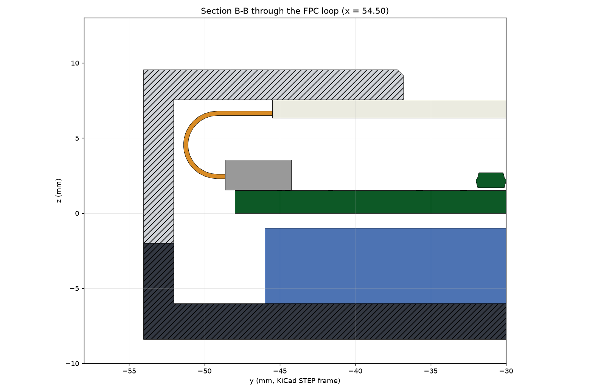

# 3D-printed enclosure for the ESP32-S3 e-paper board

A two-part FDM enclosure (base + lid) for [pcb-esp32s3-epaper](https://github.com/haiha-ux/pcb-esp32s3-epaper)
(commit `e416b79`) with its 2.9" Good Display GDEY029T94 panel. It is parametric and built with build123d. Every
board position comes from the KiCad files through `kicad-cli` and the KiCad Python API, and nothing is measured by
hand. One script rebuilds the parts, writes the drawings, renders and slices them, then checks every claim below.

## Result

| | Base | Lid |
|---|---|---|
| Size (mm) | 87.58 × 97.54 × 10.40 | 87.58 × 97.54 × 11.55 |
| Volume (mm³) | 24 303 | 20 431 |
| Thinnest wall (ray test) | 1.665 mm | 1.600 mm |
| OrcaSlicer, generic 0.4 mm / 0.2 mm / 20 % PLA | 2 h 45 min, 22.9 g | 2 h 42 min, 22.2 g |
| Print orientation | floor on the bed, no overhang > 45° | top plate on the bed, 123 mm² of overhang > 45° (top edges of the USB-C and Qwiic openings) |

Closed size with screw heads: 87.6 × 97.5 × 20.3 mm. `verify/verify.py` ends at 74/74 checks, and
`verify/break_test.py` breaks the design five ways and confirms that each break fails the matching check.

## What is in the box

| Part | Fit |
|---|---|
| Board | Sits on four base standoffs. H2 and H4 (under the panel) take M3×6 screws into the base. H1 and H3 take M3×14 screws from the top, through the lid and the board, so they also hold the lid down. |
| Lid | Two more M3×12 screws at the top corners. All six screws go into ruthex RX-M3x5.7 heat-set inserts in the base: hole 4.0 mm, 6.7 mm deep, wall 1.7 mm. |
| E-paper panel | Bonded face-up to the underside of the lid, located by ribs, with its FPC looping 180° into J4. The window is exactly the panel's 67.70 × 29.86 mm viewing area. |
| USB-C (J1) | 9.0 × 3.2 mm opening on the J1 axis. A 0.4 mm exterior recess (12.85 × 7.0 overmold + 0.3 mm) brings the wall in front of the connector down to 1.6 mm. |
| Qwiic (J3) | 7.6 × 3.4 mm opening in the right wall for the SHR-04V plug. |
| Battery | A 50 × 34 × 5 mm pocket under the board, with the cable entering J2 (PHR-2) through the left-hand gap. |
| RESET (SW1) | Ø2.2 pin hole with a guide tube that stops 0.9 mm above the button. The pin reaches the button 6.5 mm below the lid surface. |
| CHG LED (D2) | Ø2.0 light hole, 6.9 mm above the LED. |

## Checks (verify/report.json)

| Check | Result |
|---|---|
| Each part is one valid solid. The STEP re-imports with volume and bbox equal to the build within 1e-6, and the STL is watertight. | pass |
| Interference between base, lid, board (all 60 STEP bodies), panel, FPC, battery, part proxies, screw heads and mating plugs | 0 mm³ for every pair |
| Board edge to side walls | 0.500 mm (≥ 0.5 required) |
| USB-C, Qwiic, RESET, LED and window positions, measured from the lid solid against KiCad | 0.000 mm error (±0.1 allowed) |
| USB-C plug: an 8.4 × 2.6 shell and a 12.85 × 7.0 overmold do not touch the lid | 0.217 mm and 0.100 mm clearance |
| Insert holes: diameter, depth, wall around them, floor under them | all 6 pass |
| OrcaSlicer CLI slice | no error, no warning |

Run everything: `python run_all.py` (Python 3.11 with build123d 0.13, trimesh, vtk, matplotlib). Tool versions are in `report.json` → `tools`
(build123d 0.13.0, OCP 8.0.1.1, ezdxf 1.4.5, trimesh 5.2.1, kicad-cli 10.0.8, OrcaSlicer 2.5.0).

## Files

| Path | What |
|---|---|
| `deliver/` | `base.step`, `lid.step`, `assembly.step` (base + lid + board), `assembly_full.step` (with panel, FPC, battery, part proxies), STLs in the STEP frame, `enclosure.3mf`, drawings (PDF + DXF), renders |
| `print/` | STLs rotated for printing, and the slicer logs and statistics |
| `spec.json` | the dimensions this design commits to, for an independent check |
| `enclosure/params.py` | every number, with its source |
| `enclosure/build.py`, `drawing/`, `verify/` | build, drawings, checks |

Coordinates match the STEP that `kicad-cli pcb export step` writes: x right, y = −y(KiCad), z up, board bottom
copper at z = −0.035.

## Sources for numbers KiCad does not have

Five parts have no 3D model in the KiCad 10 library: J1, SW1, SW2, J2 and J4. They are boxes with the F.Fab outline
from the footprint and the height from the datasheet:

- **HRO TYPE-C-31-M-12:** 3.16 mm tall.
- **XKB TS-1187A:** 1.5 mm tall.
- **JST S2B-PH-SM4-TB:** 5.5 mm tall (JST PH catalogue, p.4).
- **Jushuo AFC07:** 2.0 mm tall (distributor page).

The panel, FPC length and viewing area come from the GDEY029T94 datasheet, p.7. Plug sizes come from the JST PH
and SH catalogues and the USB Type-C overmold limit. The full list with URLs is in `params.py` → `SOURCES`.

## Not certain

1. The panel layout is forced by the board.
   - The GDEY029T94 FPC leaves the panel's short side, and J4 faces the board's bottom edge. The panel therefore lies
     along y, sticks out 35 mm past the top edge of the board, and sets the size of the enclosure.
   - The BOOT button (SW2) and the status LED (D3) end up under the panel and cannot be reached. Download mode
     normally works over the native USB without BOOT, but this has not been tested on this board.
2. FPC loop.
   - The tail is modelled as leaving the glass 0.3 mm above its underside and entering J4 0.9 mm above the board.
     Both heights are assumptions. The loop radius comes out at 2.1 mm, and the datasheet gives no minimum bend radius.
   - The contact side after a 180° fold has not been checked against J4, which is bottom contact. The board's own
     README flags the same point.
3. Antenna clearance.
   - Espressif asks for 15 mm of clearance from metal around the module antenna (HDG p.33).
   - The battery is 6.2 mm from the antenna area, and the panel sits 1.6 mm above part of it. The effect on range has
     not been measured.
4. USB-C mating depth. The receptacle mouth is 2.2 mm behind the recess floor. Whether a given plug seats fully
   depends on its exposed shell length, which was not checked against the USB-C plug drawing.
5. Battery. The cell size (50 × 34 × 5 mm, a 1000 mAh "503450") is assumed. Measure your cell and change `BATT`.
6. Lid fixing. There is no screw at the bottom-right corner (no room between the FPC loop and the board), so the
   lid is held at four points. The panel is held only by tape on the lid.
7. Unconfirmed sources.
   - The J4 height comes from a distributor page.
   - The insert depth rule (insert length + 1 mm) comes from a secondary source.
   - The slicer profile is generic, so the print times and weights are indicative only.
