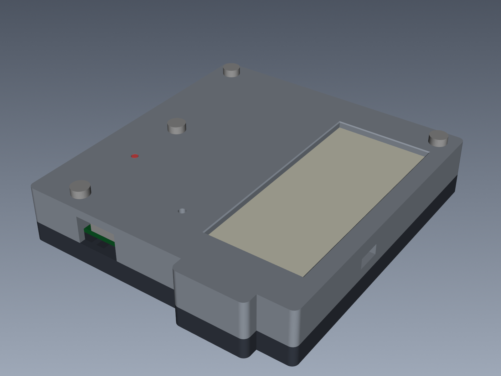

# 3D-printed enclosure for the ESP32-S3 e-paper board

A two-part FDM enclosure (base + lid) for [pcb-esp32s3-epaper](https://github.com/haiha-ux/pcb-esp32s3-epaper)
(commit `e416b79`) with its 2.9" Good Display GDEY029T94 panel. It is parametric and built with build123d. Every
board position comes from the KiCad files through `kicad-cli` and the KiCad Python API, and nothing is measured by
hand. One script rebuilds the parts, writes the drawings, renders and slices them, then checks every claim below.

## Known limitations

These come from the board layout and cannot be fixed in the enclosure. Read them before using this design.

- Antenna. Espressif's hardware design guidelines ask for at least 15 mm of clearance from metal around the module
  antenna, in all directions.
  - The e-paper panel covers 7.2 mm of the antenna's 18 mm width, 1.6 mm above it, and runs 31.8 mm past the antenna end.
  - The battery is 8.1 mm from the antenna area.
  - Range has not been measured. Compare RSSI with the board open and closed before relying on the radio.
- Buttons and LED. The panel has to lie along the board and cover its right half, because the GDEY029T94 tail leaves
  the panel's short side and J4 faces the board's bottom edge. This hides the BOOT button (SW2) and the status LED
  (D3). RESET and the charge LED stay reachable. Download mode over the native USB normally works without BOOT, but
  this has not been tested on this board.

## Result

Not printed or assembled. Every fit statement below is a CAD check only.

| | Base | Lid |
|---|---|---|
| Size (mm) | 87.58 × 96.54 × 10.40 | 87.58 × 96.54 × 13.55 (incl. 2 mm locating lip) |
| Volume (mm³) | 24 045 | 21 478 |
| Thinnest wall (ray test) | 1.665 mm | 1.699 mm |
| Narrowest slot inside the part | 1.60 mm | 2.10 mm |
| OrcaSlicer, generic 0.4 mm / 0.2 mm / 20 % PLA | 2 h 44 min, 22.6 g | 2 h 55 min, 23.5 g |
| Print orientation | floor on the bed, no overhang > 45° | top plate on the bed. 518 mm² of overhang > 45°, almost all of it the flat 1.9 mm shelf that ties the lip to the wall. It prints as a short unsupported ledge; slice it first and check that ledge if your printer is weak on overhangs. |

Closed size with screw heads: 87.6 × 96.5 × 20.3 mm. `verify/verify.py` ends at 83/83 checks. `verify/break_test.py`
breaks the design six ways and confirms that each break fails the matching check.

## Parts and fits

| Part | Fit |
|---|---|
| Board | Sits on four base standoffs. H2 and H4 (under the panel) take M3×6 screws into the base. H1 and H3 take M3×14 screws from the top, through the lid and the board. |
| Lid | Two M3×12 screws at the top corners. A 1.7 mm lip hangs 2 mm into the base, 0.2 mm inside its wall, on the back and both sides. The front edge has no lip, because the USB-C pocket, the battery and two bosses fill it, so the H1 and H3 screws locate the lid there. The lip is cut 1 mm clear of the battery pocket, to allow for cells that are ±1 mm off size. All six screws go into ruthex RX-M3x5.7 heat-set inserts: hole 4.0 mm, 6.7 mm deep, wall 1.7 mm. |
| E-paper panel | Taped face-up to the underside of the lid and located by ribs. The window is exactly the 67.70 × 29.86 mm viewing area. The FPC loops 180° into J4 with a 1.5 mm straight run in front of the connector. The 4.5 mm strip on the FPC side of the glass is the driver IC bonding area: keep tape off it. The lid has a 0.3 mm relief over it. |
| USB-C (J1) | A 13.45 × 7.6 mm pocket goes right through the wall, so a 12.85 × 7.0 overmold reaches the board edge, 0.1 mm from the receptacle mouth. That puts the overmold face 6.3 mm from the mating datum, inside the 6.5 mm the USB-IF locking spec allows. The mouth position is the front edge of the KiCad F.Fab outline of J1; it has not been checked against the HRO drawing. With no plug fitted, the pocket (13.45 × 8.92 mm, open to the parting line) leaves the connector exposed. |
| Qwiic (J3) | 7.6 × 3.4 mm opening in the right wall for the SHR-04V plug. |
| Battery | 50 × 34 × 5 mm pocket under the board, against the front wall and as far from the antenna as the board allows. The cable enters J2 (PHR-2) through the left-hand gap. |
| RESET (SW1) | Ø2.2 pin hole with a guide tube that stops 0.9 mm above the button. The pin reaches the button 6.5 mm below the lid surface. |
| CHG LED (D2) | A Ø2 mm PMMA rod used as a light pipe, held in a Ø2.2 mm bore in the 2 mm lid plate. Cut it 6.35 mm long and glue it flush with the lid top, so it ends 0.5 mm above the LED and cannot be pushed onto it. |

### Assembly order

1. Print one insert boss as a test coupon first, because the right insert hole depends on the printer. Then press the
   six inserts into the base.
2. Put the battery in its pocket and plug it into J2.
3. Screw the board down at H2 and H4 (M3×6).
4. Tape the panel to the lid. Insert the FPC into J4 and close the latch.
5. Glue the 6.35 mm light-pipe rod into the lid, flush with the top.
6. Close the lid. Fit M3×14 at H1 and H3, and M3×12 at the two top corners.

## Checks (verify/report.json)

| Check | Result |
|---|---|
| Each part is one valid solid. The STEP re-imports with volume and bbox equal to the build within 1e-6, and the STL is watertight. | pass |
| Interference between base, lid, board (all 412 solids of the KiCad STEP), panel, FPC, battery, light pipe, part proxies, screw heads and seated plugs | 0 mm³ for every pair |
| Board edge to side walls | 0.500 mm (≥ 0.5 required) |
| USB-C, Qwiic, RESET, LED and window positions, measured from the lid solid against KiCad | 0.000 mm error (±0.1 allowed) |
| USB-C overmold to receptacle mouth (allowed ≤ 0.35) | 0.10 mm, stopped by the board edge |
| Seated USB-C plug: shell 8.4 × 2.6 and overmold 12.85 × 7.0 against the lid | 2.55 mm and 0.30 mm clearance |
| Insert holes: diameter, depth, wall around them, floor under them | all 6 pass |
| No slot under 0.8 mm (two extrusion lines) in either part | pass (narrowest: base 1.60, lid 2.20 mm) |
| Thinnest wall, rays from every 0.5 mm patch of the surface | base 1.665, lid 1.699 mm |
| OrcaSlicer CLI slice | no error, no warning |

Run everything: `python run_all.py` (Python 3.11 with build123d 0.13, trimesh, vtk, matplotlib). Tool versions are in
`report.json` → `tools` (build123d 0.13.0, OCP 8.0.1.1, ezdxf 1.4.5, trimesh 5.2.1, kicad-cli 10.0.8, OrcaSlicer 2.5.0).

## Files

| Path | What |
|---|---|
| `deliver/` | `base.step`, `lid.step`, `assembly.step` (base + lid + board), `assembly_full.step` (with panel, FPC, battery, light pipe, part proxies), STLs in the STEP frame, `enclosure.3mf`, drawings (PDF + DXF, A3, third-angle), renders |
| `print/` | STLs rotated for printing, and the slicer statistics |
| `spec.json` | the dimensions this design commits to, for an independent check |
| `enclosure/params.py` | every number, with its source |
| `enclosure/build.py`, `drawing/`, `verify/` | build, drawings, checks |

Coordinates match the STEP that `kicad-cli pcb export step` writes: x right, y = −y(KiCad), z up, board bottom
copper at z = −0.035.

## Sources for numbers KiCad does not have

Five parts have no 3D model in the KiCad 10 library: J1, SW1, SW2, J2 and J4. They are boxes with the F.Fab outline
from the footprint and the height from the datasheet:

- **HRO TYPE-C-31-M-12:** 3.16 mm.
- **XKB TS-1187A:** 1.5 mm.
- **JST S2B-PH-SM4-TB:** 5.5 mm (JST PH catalogue, p.4).
- **Jushuo AFC07-S24FCA-00:** 2.0 mm, bottom contact, slide lock (distributor pages).

The panel outline, stepped glass, FPC length and viewing area come from the GDEY029T94 datasheet, p.7. The plug
sizes come from the JST PH and SH catalogues and the USB Type-C overmold limit. The USB-C mating depths come from the
USB Type-C locking connector specification and the source listed for it. The full list with URLs is in `params.py` →
`SOURCES`.

## Not certain

1. FPC loop. The tail is modelled as leaving the glass 0.3 mm above its underside and entering J4 0.9 mm above the
   board, with a loop radius of 2.1 mm. The datasheet gives no minimum bend radius. It also has not been checked that
   the tail's contacts face down at J4 after the 180° fold. The board's own README raises the same point.
2. The split of the 1.2 mm glass into a 0.6 mm TFT layer and a 0.6 mm top layer is assumed. Only the outlines come
   from the datasheet.
3. The battery size (a 1000 mAh "503450" cell, 50 × 34 × 5 mm) is assumed. Measure your cell and change `BATT`.
4. The J4 height and contact side come from distributor pages. The insert depth rule (insert length + 1 mm) comes from
   a secondary source. The slicer profile is generic, so the print times and weights are only a guide.
